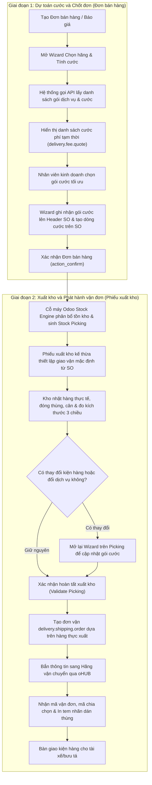
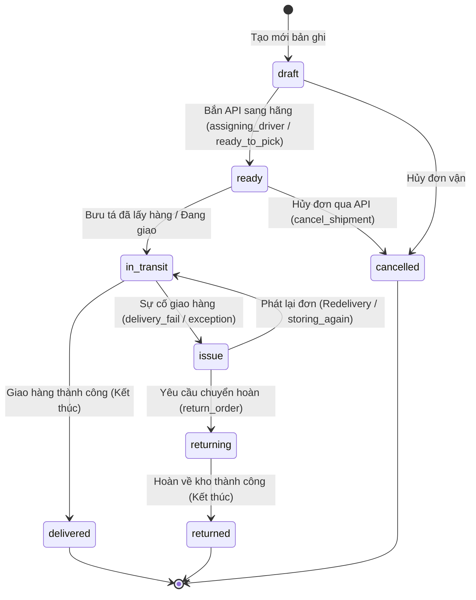
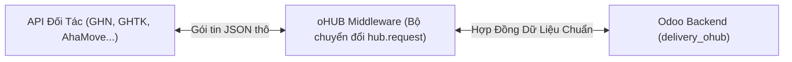
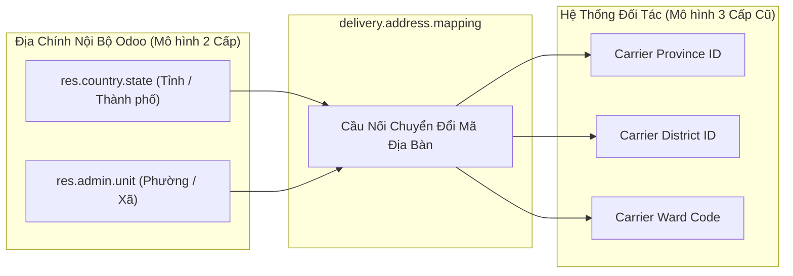

# Tích Hợp Giao Vận Đa Đơn Vị Qua ORIS Hub (delivery_ohub)

Tài liệu đặc tả kiến trúc, giải pháp nghiệp vụ và hướng dẫn kỹ thuật cho module `delivery_ohub`.

---

## Mục Lục

- [1. Tổng Quan Giải Pháp](#1-tổng-quan-giải-pháp)
- [2. Yêu Cầu Cài Đặt Và Phụ Thuộc](#2-yêu-cầu-cài-đặt-và-phụ-thuộc)
- [3. Luồng Nghiệp Vụ Người Dùng](#3-luồng-nghiệp-vụ-người-dùng)
- [4. Các Model Bổ Sung Và Mở Rộng](#4-các-model-bổ-sung-và-mở-rộng)
- [5. Quyết Định Kiến Trúc: Tiền Tệ Đơn Vị Vận Chuyển (Carrier Currency)](#5-quyết-định-kiến-trúc-tiền-tệ-đơn-vị-vận-chuyển-carrier-currency)
- [6. Quan Hệ Stock Picking Và Cơ Chế Đặt Lại Đơn Vận](#6-quan-hệ-stock-picking-và-cơ-chế-đặt-lại-đơn-vận)
- [7. Biểu Giá Đơn Vận Và Cơ Chế Tính Tiền Thu Hộ (COD)](#7-biểu-giá-đơn-vận-và-cơ-chế-tính-tiền-thu-hộ-cod)
- [8. Cấu Hình oHUB Mapping Và Hợp Đồng Dữ Liệu Chuẩn](#8-cấu-hình-ohub-mapping-và-hợp-đồng-dữ-liệu-chuẩn)
- [9. Quản Lý Địa Chính Đa Cấp Và Mô Hình 2 Cấp Cho Việt Nam](#9-quản-lý-địa-chính-đa-cấp-và-mô-hình-2-cấp-cho-việt-nam)
- [10. Chuyển Đổi Địa Chính (delivery.address.mapping)](#10-chuyển-đổi-địa-chính-deliveryaddressmapping)
- [11. Các Tính Năng Mở Rộng Đáng Chú Ý](#11-các-tính-năng-mở-rộng-đáng-chú-ý)

---

## 1. Tổng Quan Giải Pháp

Module `delivery_ohub` là giải pháp tích hợp giao vận đa đơn vị vận chuyển (Multi-carrier Shipping Integration) cho Odoo 18 thông qua kiến trúc trung gian oHUB (ORIS Hub).

### Mục Tiêu Kiến Trúc

Trong việc phát triển tích hợp logistics trên Odoo, việc lập trình trực tiếp kết nối API của từng đơn vị vận chuyển (Giao Hàng Nhanh, Giao Hàng Tiết Kiệm, AhaMove, Viettel Post...) vào backend Odoo thường dẫn đến mã nguồn bị liên kết quá chặt chẽ (tight coupling), khó bảo trì, khó mở rộng và dễ phát sinh lỗi khi đối tác thay đổi phiên bản API.

Giải pháp cốt lõi của module `delivery_ohub` là phân tách hoàn toàn hai tầng kiến trúc:
- **Tầng Nghiệp Vụ Hệ Thống (Odoo Backend - Business Domain Layer)**: Đảm nhiệm quản lý quy trình thương mại bán hàng, luân chuyển kho vận, trạng thái đơn vận và trải nghiệm người dùng thông qua một **Hợp Đồng Dữ Liệu Chuẩn (Standard Data Contract)** duy nhất.
- **Tầng Trung Gian Tích Hợp (oHUB Middleware - Integration Layer)**: Đóng vai trò là cổng API Gateway xử lý xác thực token, kết nối mạng, bảo mật, ghi nhật ký giao dịch và áp dụng các bộ quy tắc chuyển đổi (Request/Response Mapping) từ định dạng dữ liệu đặc thù của từng hãng sang lược đồ chuẩn mà Odoo yêu cầu.

### Các Khả Năng Chính Của Module

- **Tra cứu giá cước và gói dịch vụ theo thời gian thực**: Hỗ trợ người dùng so sánh trực quan các gói cước (Tiêu chuẩn, Hỏa tốc, Tiết kiệm...) cùng chi phí dự tính ngay khi lập báo giá trên Đơn bán hàng hoặc khi đóng gói hàng hóa tại Phiếu xuất kho.
- **Quản lý địa chính 2 cấp tinh gọn cho Việt Nam**: Chuẩn hóa mô hình hành chính 2 cấp (Tỉnh/Thành phố và Phường/Xã/Thị trấn), giúp tối ưu hóa thao tác nhập liệu và phù hợp với xu hướng tinh gọn tổ chức hành chính.
- **Cầu nối chuyển đổi địa chính từ 2 cấp sang 3 cấp**: Tự động chuyển đổi thông tin địa bàn 2 cấp nội bộ của Odoo sang hệ thống mã định danh 3 cấp truyền thống của các đơn vị vận chuyển (Province ID, District ID, Ward Code).
- **Vòng đời đơn vận độc lập (`delivery.shipping.order`)**: Gắn chặt với kiện hàng thực tế của từng lần xuất kho (`stock.picking`), quản lý toàn diện các trạng thái từ khởi tạo, bàn giao bưu tá, luân chuyển, phát sinh sự cố cho đến chuyển hoàn.
- **Cơ chế tính tiền thu hộ (COD) và ngăn chặn thu cước trùng lặp**: Tự động khấu trừ công nợ thực tế của khách hàng, phân biệt rõ giữa kiện hàng đầu tiên và các đợt giao bổ sung (Backorder), đồng thời xử lý chính xác chính sách thanh toán cước (Shop trả cước hoặc Khách trả cước).
- **Hỗ trợ đặt lại đơn vận linh hoạt**: Cho phép hủy đơn cũ để tạo đơn mới khi kiện hàng thay đổi, phát lại đơn khi giao hàng thất bại, hoặc tạo đơn vận mới khi kiện hàng bị chuyển hoàn về kho.
- **Xử lý đa tiền tệ thông suốt**: Tự động quy đổi tỷ giá giữa loại tiền tệ của hãng vận chuyển (ví dụ: VND) và loại tiền tệ của đơn hàng hoặc công ty (ví dụ: USD, EUR).
- **Đồng bộ hành trình tự động qua Webhook**: Tiếp nhận thông báo thay đổi trạng thái từ hãng vận chuyển theo thời gian thực, lưu vết nhật ký chi tiết phục vụ kiểm toán và chăm sóc khách hàng.

---

## 2. Yêu Cầu Cài Đặt Và Phụ Thuộc

### Yêu Cầu Môi Trường

- Phiên bản nền tảng: Odoo 18.0 Community hoặc Enterprise.
- Môi trường lập trình: Python 3.10 trở lên.

### Các Module Phụ Thuộc (Dependencies)

Module yêu cầu cài đặt trước các module sau trong file [__manifest__.py](file:///c:/University/Study/Programming/reference/odoo-all/exercise-odoo-18/custom_addons/delivery_ohub/__manifest__.py):

```python
'depends': [
    'delivery',
    'stock_delivery',
    'oris_hub',
],
```

- `delivery`: Module tiêu chuẩn của Odoo cung cấp khung cơ sở về phương thức giao hàng (`delivery.carrier`) và tạo dòng cước vận chuyển trên đơn hàng.
- `stock_delivery`: Tích hợp quy trình xử lý giao vận vào phiếu xuất kho (`stock.picking`).
- `oris_hub`: Module nền tảng đóng vai trò trung gian tích hợp, quản lý luồng dữ liệu `hub.flow`, danh mục yêu cầu `hub.request`, xác thực tài khoản và bộ biến đổi dữ liệu.

### Dữ Liệu Khởi Tạo Cần Chuẩn Bị

Trước khi đưa vào vận hành thực tế, người quản trị cần chuẩn bị:
- Danh mục đơn vị hành chính Việt Nam nạp vào model `res.admin.unit`.
- Thiết lập kết nối trên oHUB bao gồm `hub.flow` cho từng đối tác vận chuyển và các `hub.request` tương ứng với từng tác vụ.
- Thiết lập phương thức giao hàng `delivery.carrier` với loại tích hợp `delivery_type = 'ohub'`.
- Nạp bảng dữ liệu chuyển đổi địa chỉ vào `delivery.address.mapping` (có thể sử dụng các script hỗ trợ di chuyển dữ liệu có sẵn trong thư mục `scripts/`).

---

## 3. Luồng Nghiệp Vụ Người Dùng

Quy trình giao vận được thiết kế phân định rành mạch giữa giai đoạn Thương mại (Kinh doanh) và giai đoạn Thực thi đóng gói (Kho vận):



### Chi Tiết Giai Đoạn 1: Bán Hàng Và Dự Toán Cước (Sales)

- Nhân viên kinh doanh tạo đơn báo giá trên `sale.order`.
- Bấm nút tính cước giao hàng để mở cửa sổ pop-up `choose.delivery.carrier`.
- Hệ thống gọi thao tác `available_services` qua oHUB để lấy toàn bộ các gói dịch vụ khả dụng cùng bảng giá cước thời gian thực. Các mức giá này được lưu dưới dạng bản ghi tạm thời trong model `delivery.fee.quote` (TransientModel).
- Nhân viên chọn gói dịch vụ phù hợp và bấm Xác nhận. Dữ liệu được sao chép từ bản ghi tạm sang các trường cố định trên Header đơn bán hàng:
  - `delivery_service_id`: Mã định danh dịch vụ của hãng vận chuyển.
  - `delivery_service_name`: Tên gói dịch vụ hiển thị.
  - `delivery_service_code`: Ký hiệu mã dịch vụ kỹ thuật.
  - `shipping_payment_type`: Hình thức thanh toán cước (Shop trả cước hoặc Khách trả cước).
- Cửa sổ Wizard đóng lại, các bản ghi cước tạm thời được giải phóng tự động. Đồng thời, một dòng chi phí giao hàng được tạo trên đơn bán hàng (`sale.order.line` với cờ `is_delivery = True`).
- **Nguyên tắc nghiệp vụ quan trọng**: Tại thời điểm xác nhận đơn bán hàng, hệ thống tuyệt đối không sinh bản ghi vận đơn `delivery.shipping.order` (kể cả bản ghi nháp). Điều này ngăn ngừa hoàn toàn tình trạng phát sinh các đơn vận "mồ côi" khi báo giá bị hủy bỏ, khách hàng từ chối nhận hoặc đơn hàng bị tách làm nhiều đợt xuất kho.

### Chi Tiết Giai Đoạn 2: Xuất Kho Và Phát Hành Vận Đơn (Warehouse)

- Khi đơn bán hàng được xác nhận, cỗ máy điều phối kho của Odoo (Odoo Stock Engine) tự động sinh phiếu xuất kho `stock.picking`.
- Phiếu xuất kho tự động kế thừa các thông tin vận chuyển đã thỏa thuận từ đơn bán hàng.
- Nhân viên kho thực hiện nhặt hàng theo danh sách sản phẩm thực tế (`move_line_ids`), tiến hành đóng thùng carton, đo đạc kích thước 3 chiều (Dài, Rộng, Cao) và cân trọng lượng thực tế của kiện hàng.
- Thủ kho có quyền giữ nguyên thiết lập mặc định hoặc mở lại Wizard trực tiếp trên phiếu xuất kho để cập nhật lại gói cước nếu kích thước, trọng lượng thực tế có sự thay đổi.
- Khi phiếu xuất kho được xác nhận hoàn tất (Validate Picking) hoặc khi thủ kho bấm nút "Tạo đơn vận":
  - Hệ thống tự động khởi tạo bản ghi `delivery.shipping.order`.
  - Tính toán chính xác giá trị tiền hàng (`goods_amount`), tiền cước tính cho kiện (`shipping_fee_amount`) và tiền thu hộ (`cod_amount`) dựa trên lượng hàng thực xuất.
  - Bắn dữ liệu sang hãng vận chuyển thông qua thao tác `create_shipment`.
  - Nhận về mã vận đơn của hãng (`order_code`), mã tra cứu (`tracking_number`), mã tuyến phân loại (`sort_code`) và hỗ trợ in tem vận đơn dán lên kiện hàng.

---

## 4. Các Model Bổ Sung Và Mở Rộng

Hệ thống thiết kế các model chuyên biệt kết hợp kế thừa mở rộng các model tiêu chuẩn của Odoo:

| Tên Model | Phân Loại | Chức Năng Nghiệp Vụ | Tệp Mã Nguồn |
| :--- | :--- | :--- | :--- |
| `res.admin.unit` | Model thông thường | Quản lý danh mục địa chính đa cấp, hỗ trợ quan hệ cây cha-con (`parent_id`, `child_ids`) | [res_admin_unit.py](file:///c:/University/Study/Programming/reference/odoo-all/exercise-odoo-18/custom_addons/delivery_ohub/models/res_admin_unit.py) |
| `delivery.address.mapping` | Model thông thường | Bảng chuyển đổi địa danh hành chính từ chuẩn 2 cấp nội bộ sang mã 3 cấp của đối tác | [delivery_address_mapping.py](file:///c:/University/Study/Programming/reference/odoo-all/exercise-odoo-18/custom_addons/delivery_ohub/models/delivery_address_mapping.py) |
| `delivery.ohub.operation` | Model thông thường | Danh mục các thao tác tích hợp của đơn vị vận chuyển, ánh xạ trực tiếp tới `hub.request` | [delivery_ohub_operation.py](file:///c:/University/Study/Programming/reference/odoo-all/exercise-odoo-18/custom_addons/delivery_ohub/models/delivery_ohub_operation.py) |
| `delivery.shipping.order` | Model thông thường | Thực thể vận đơn cốt lõi, quản lý kích thước, trọng lượng, biểu giá, tiền COD và hành trình | [delivery_shipping_order.py](file:///c:/University/Study/Programming/reference/odoo-all/exercise-odoo-18/custom_addons/delivery_ohub/models/delivery_shipping_order.py) |
| `delivery.shipping.order.log` | Model thông thường | Nhật ký lịch sử biến động trạng thái và tiến trình luân chuyển vận đơn | [delivery_shipping_order_log.py](file:///c:/University/Study/Programming/reference/odoo-all/exercise-odoo-18/custom_addons/delivery_ohub/models/delivery_shipping_order_log.py) |
| `delivery.fee.quote` | TransientModel | Bảng lưu trữ tạm thời các gói cước tra cứu từ API trong phiên làm việc của Wizard | [delivery_fee_quote.py](file:///c:/University/Study/Programming/reference/odoo-all/exercise-odoo-18/custom_addons/delivery_ohub/wizard/delivery_fee_quote.py) |
| `delivery.carrier` | Kế thừa mở rộng | Bổ sung phương thức `ohub`, luồng tích hợp, địa chỉ kho gửi, tiền tệ và danh mục thao tác | [delivery_carrier.py](file:///c:/University/Study/Programming/reference/odoo-all/exercise-odoo-18/custom_addons/delivery_ohub/models/delivery_carrier.py) |
| `sale.order` | Kế thừa mở rộng | Lưu trữ thông tin thỏa thuận giao vận mặc định và liên kết truy xuất danh sách vận đơn | [sale_order.py](file:///c:/University/Study/Programming/reference/odoo-all/exercise-odoo-18/custom_addons/delivery_ohub/models/sale_order.py) |
| `stock.picking` | Kế thừa mở rộng | Liên kết 1-n với đơn vận, quản lý kích thước thực tế và cơ chế phát hành vận đơn tự động | [stock_picking.py](file:///c:/University/Study/Programming/reference/odoo-all/exercise-odoo-18/custom_addons/delivery_ohub/models/stock_picking.py) |
| `res.partner` | Kế thừa mở rộng | Bổ sung trường xã/phường `ward_id` và hàm kiểm tra tính đầy đủ của địa chỉ giao hàng | [res_partner.py](file:///c:/University/Study/Programming/reference/odoo-all/exercise-odoo-18/custom_addons/delivery_ohub/models/res_partner.py) |
| `product.template` | Kế thừa mở rộng | Bổ sung các thông số kích thước Dài, Rộng, Cao phục vụ ước lượng thể tích tự động | [product_template.py](file:///c:/University/Study/Programming/reference/odoo-all/exercise-odoo-18/custom_addons/delivery_ohub/models/product_template.py) |
| `choose.delivery.carrier` | Kế thừa mở rộng | Nâng cấp Wizard để sử dụng linh hoạt tại cả Đơn bán hàng và Phiếu xuất kho | [choose_delivery_carrier.py](file:///c:/University/Study/Programming/reference/odoo-all/exercise-odoo-18/custom_addons/delivery_ohub/wizard/choose_delivery_carrier.py) |

---

## 5. Quyết Định Kiến Trúc: Tiền Tệ Đơn Vị Vận Chuyển (Carrier Currency)

### Bối Cảnh Và Thách Thức

Trong các doanh nghiệp thương mại quốc tế hoặc hệ thống có nhiều chi nhánh:
- Tiền tệ hạch toán của công ty có thể là USD, EUR hoặc các ngoại tệ khác.
- Đơn bán hàng có thể được lập và thanh toán bằng ngoại tệ theo hợp đồng.
- Tuy nhiên, các hãng vận chuyển nội địa tại Việt Nam (GHN, GHTK, Viettel Post, AhaMove...) luôn báo giá và tính cước phí bằng đồng Việt Nam (VND).

Nếu không tách biệt rõ ràng giữa tiền tệ của đơn vị vận chuyển và tiền tệ của chứng từ, hệ thống sẽ gặp lỗi khi gửi sai định dạng tiền sang API đối tác, hoặc gây chênh lệch tỷ giá nghiêm trọng trong quá trình ghi nhận công nợ.

### Giải Pháp Thiết Kế

Module bổ sung trường tiền tệ `currency_id` trực tiếp trên thực thể `delivery.carrier` với các cơ chế:
- **Tiền tệ của đơn vị vận chuyển (`carrier.currency_id`)**: Đại diện cho loại tiền tệ chính thức mà dịch vụ giao vận sử dụng (mặc định là VND).
- **Quy tắc xác định tự động (`_compute_carrier_currency_id`)**: Ưu tiên lấy từ sản phẩm dịch vụ giao vận (`product_id.currency_id`), sau đó đến tiền tệ công ty (`company_id.currency_id`) hoặc tiền tệ hệ thống.
- **Cơ chế chuyển đổi tỷ giá hai chiều (`_convert_currency` và `_get_conversion_currencies`)**:
  - *Chiều Tra cứu cước (Incoming)*: API trả về cước phí bằng VND. Hệ thống tự động quy đổi số tiền cước sang tiền tệ của đơn bán hàng hoặc phiếu xuất kho dựa trên tỷ giá tại ngày của chứng từ.
  - *Chiều Tạo đơn vận (Outgoing)*: Giá trị khai giá bảo hiểm (`insurance_value`), giá trị hàng thực xuất (`goods_amount`), cước phí và tiền thu hộ (`cod_amount`) được quy đổi từ tiền tệ đơn hàng sang tiền tệ của hãng (VND) trước khi đưa vào gói tin gửi sang đối tác.

Nhờ quyết định kiến trúc này, doanh nghiệp có thể bán hàng bằng bất kỳ loại ngoại tệ nào mà vẫn kết nối giao vận nội địa chuẩn xác.

---

## 6. Quan Hệ Stock Picking Và Cơ Chế Đặt Lại Đơn Vận

### Lý Do Đơn Vận Gắn Chặt Với Stock Picking

Việc thiết kế `delivery.shipping.order` liên kết trực tiếp với `stock.picking` mang lại các giá trị nghiệp vụ vững chắc:

- **Thừa hưởng trọn vẹn cỗ máy điều phối kho của Odoo (Stock Engine)**:
  - Tự động đáp ứng các kịch bản kho phức tạp: giao hàng nhiều đợt do thiếu hàng (Backorder), xuất hàng từ nhiều kho vật lý khác nhau (Multi-warehouse) hoặc quy trình xuất kho nhiều bước (2-step, 3-step Delivery).
  - Mỗi phiếu xuất kho tương ứng với một lần giao nhận vật lý cụ thể, đảm bảo kiện hàng phản ánh đúng thực tế đóng gói.
- **Ngăn ngừa phát sinh đơn vận mồ côi (Orphan Orders)**: Tránh tình trạng đơn hàng bị hủy hoặc sửa đổi nhưng đơn vận đã gửi sang hãng vẫn tồn tại độc lập gây thất thoát và nhầm lẫn.
- **Tính toán chính xác theo hàng thực xuất**: Đơn vận tính trọng lượng, kích thước và giá trị tiền thu hộ dựa trên dòng điều chuyển thực tế (`move_line_ids`) của phiếu xuất kho đó.

### Quan Hệ One2many Và Quy Tắc Quản Lý Trạng Thái Hiệu Lực (Active State Rule)

Về mặt cơ sở dữ liệu, quan hệ giữa `stock.picking` và `delivery.shipping.order` là quan hệ **One2many** (`shipping_order_ids`).

Tuy nhiên, về quy tắc vận hành nghiệp vụ: **Tại một thời điểm, mỗi phiếu xuất kho chỉ được phép có tối đa 1 đơn vận ở trạng thái hoạt động (Active)**.

Một đơn vận được coi là đã đóng hoặc kết thúc (Inactive) khi rơi vào một trong các trạng thái sau:
- `cancelled`: Đơn vận đã được hủy thành công trên hệ thống của hãng.
- `returned`: Kiện hàng đã được đối tác bưu cục chuyển hoàn về lại kho.
- `delivered`: Kiện hàng đã giao thành công trọn vẹn đến người nhận.



### Cơ Chế Hỗ Trợ Đặt Lại Đơn Vận (Cancel & Re-create / Redelivery / Re-ship)

Hệ thống hỗ trợ toàn diện các tình huống biến động thực tế tại kho vận:

- **Hủy đơn cũ và Tạo lại đơn mới (Cancel & Re-create)**:
  - Trường hợp sử dụng: Bưu tá không đến lấy hàng, in sai tem nhãn, thùng hàng bị rách vỡ cần đóng gói lại, hoặc khách yêu cầu đổi sang hãng vận chuyển/gói dịch vụ khác.
  - Xử lý: Người dùng bấm nút "Hủy đơn vận" trên `delivery.shipping.order`. Hệ thống gọi thao tác `cancel_shipment` sang hãng qua oHUB và chuyển trạng thái đơn cũ sang `cancelled`.
  - Khi đơn cũ đã ở trạng thái hủy, phiếu xuất kho không còn active shipping order. Thủ kho có thể mở lại Wizard chọn gói dịch vụ mới và bấm "Tạo đơn vận" (`action_create_shipping_order`) để cấp mã vận đơn mới (`client_order_code`). Bản ghi đơn cũ vẫn được lưu giữ phục vụ việc đối soát chi phí.
- **Phát lại trên cùng mã vận đơn (Redelivery)**:
  - Trường hợp sử dụng: Đơn hàng giao không thành công lần 1 hoặc lần 2 do người nhận đổi giờ hẹn hoặc không nghe máy (`issue`, `delivery_fail`).
  - Xử lý: Thay vì hủy đơn, thủ kho bấm nút "Phát lại" (`action_redeliver`). Hệ thống gửi lệnh `storing_again` sang hãng vận chuyển để bưu cục xếp lịch giao lại mà không cần tạo mới mã vận đơn.
- **Chuyển hoàn và Xuất giao lại (Return & Re-ship)**:
  - Trường hợp sử dụng: Kiện hàng bị chuyển hoàn về kho (`returned`). Sau khi kiểm tra hàng và liên hệ lại với khách, thủ kho có thể tạo đơn vận mới ngay trên chính phiếu xuất kho đó.
- **Bảo vệ chống trùng lặp đơn đã giao thành công**:
  - Khi phiếu xuất kho đã có đơn vận ở trạng thái `delivered`, hệ thống khóa hoàn toàn chức năng tạo đơn mới nhằm triệt tiêu nguy cơ gửi thừa hàng cho khách.
- **Cơ chế chống nghẽn kho khi tự động tạo đơn (Resilient Savepoint)**:
  - Khi kích hoạt tính năng tự động tạo đơn vận khi xác nhận kho (`auto_create_shipping_on_validate`), hệ thống bọc lệnh gọi API trong một khối điểm lưu trữ (`cr.savepoint()`).
  - Nếu API đối tác bị mất kết nối hoặc quá thời gian chờ (timeout), phiếu xuất kho vẫn hoàn tất quy trình xuất kho bình thường. Bản ghi đơn vận được tạo ở trạng thái lỗi kèm thông báo rõ trên Chatter, cho phép thủ kho bấm nút "Gửi sang hãng" thủ công sau đó mà không làm đình trệ công việc đóng gói của kho.

---

## 7. Biểu Giá Đơn Vận Và Cơ Chế Tính Tiền Thu Hộ (COD)

### Các Biểu Giá Trên Đơn Vận

Module quản lý minh bạch giữa giá cước ước tính ban đầu và chi phí thực tế:

- **Cước phí ước tính ban đầu (`estimated_fee`)**: Chi phí vận chuyển dự tính khi tra cứu gói cước trên đơn bán hàng hoặc phiếu xuất kho.
- **Cước phí thực tế (`actual_total_fee`)**: Chi phí chính thức mà hãng vận chuyển ghi nhận sau khi tạo đơn hoặc sau khi kiện hàng được cân đo lại tại trung tâm khai thác (Hub).
- **Phân tách cấu trúc phí chi tiết**:
  - `service_fee`: Cước phí vận chuyển chính.
  - `insurance_fee`: Phí bảo hiểm và khai báo giá trị hàng hóa.
  - `cod_fee`: Phí dịch vụ thu tiền hộ (nếu hãng có tính phí riêng).
  - `cod_failed_amount`: Phí thu từ người nhận trong trường hợp giao hàng thất bại (nếu có thỏa thuận).

### Chính Sách Thanh Toán Cước (Shipping Payment Type)

Hệ thống hỗ trợ 2 hình thức thanh toán cước tiêu chuẩn:
- **Loại 1: Shop trả cước (Sender / Shop Pays)**:
  - Doanh nghiệp đứng ra thanh toán toàn bộ chi phí vận chuyển cho hãng logistics.
  - Nếu khách hàng chưa thanh toán tiền cước trên đơn hàng, khoản cước này sẽ được tự động cộng vào số tiền COD để thu từ khách khi giao hàng.
- **Loại 2: Khách tự trả cước (Recipient Pays)**:
  - Khách hàng tự thanh toán trực tiếp tiền cước vận chuyển cho tài xế/bưu tá khi nhận hàng.
  - Cước vận chuyển tuyệt đối **không được cộng vào tiền COD**, bảo đảm không xảy ra tình trạng khách hàng bị thu cước hai lần.

### Cơ Chế Tính COD Và Khấu Trừ Công Nợ Tự Động

Công thức tính tiền thu hộ (COD) trên từng kiện hàng được thiết kế chặt chẽ nhằm bảo vệ quyền lợi tài chính của doanh nghiệp:

```text
Tiền Hàng Của Kiện = Tổng giá trị các dòng thực xuất trên phiếu xuất kho (move_line_ids)

Tiền Cước Thu Của Khách = 
    Nếu Loại thanh toán cước = '1' VÀ là kiện xuất đầu tiên (chưa có đơn active trước đó)
    Thì: Lấy tiền cước giao hàng trên dòng đơn bán hàng
    Ngược lại: 0 (Đơn giao bổ sung Backorder hoặc Khách tự trả cước)

Tổng Công Nợ Đơn Hàng = Giá trị tổng đơn bán hàng - Tiền khách đã thanh toán trước
(Khoản thanh toán trước được tổng hợp từ Hóa đơn đã vào sổ hoặc Giao dịch thanh toán online thành công)

Công Nợ Còn Lại = Tổng Công Nợ Đơn Hàng - Tổng tiền COD của các đơn vận đang active trước đó

Số Tiền COD Chốt Cho Kiện = Min(Tiền Hàng Của Kiện + Tiền Cước Thu Của Khách, Công Nợ Còn Lại)
```

### Quy Tắc Ngăn Chặn Thu Cước Trùng Lặp Trên Backorder

Khi một đơn hàng bị tách làm nhiều đợt xuất kho (Backorder):
- Kiện hàng xuất kho đầu tiên sẽ đảm nhiệm thu tiền cước giao hàng (nếu áp dụng Shop trả cước).
- Tất cả các phiếu xuất kho phát sinh từ đợt 2 trở đi (Backorder) tự động được gán chính sách `shipping_payment_type = '1'` với tiền cước tính cho kiện bằng 0.
- Hệ thống chủ động ngăn chặn người dùng chọn chính sách Khách tự trả cước (Loại 2) trên kiện đầu nếu trên đơn hàng đã tính tiền giao hàng, loại bỏ triệt để nguy cơ thu cước hai lần từ khách hàng.

---

## 8. Cấu Hình oHUB Mapping Và Hợp Đồng Dữ Liệu Chuẩn

### Nguyên Lý Kiến Trúc Hợp Đồng Dữ Liệu Chuẩn

Để xóa bỏ hoàn toàn việc mã nguồn Python phải "dò đoán" tên trường của từng hãng vận chuyển bằng các chuỗi `.get()` liên tiếp (heuristic probing), hệ thống áp dụng nguyên lý Hợp Đồng Dữ Liệu Chuẩn:

- Odoo Backend xác định rõ các trường bắt buộc và kiểm tra hợp lệ thông qua hàm `_validate_contract_payload`. Nếu thiếu dữ liệu cốt lõi, hệ thống sẽ báo lỗi trực tiếp thay vì hoạt động sai lệch trong âm thầm.
- oHUB chịu trách nhiệm tiếp nhận gói tin thô (raw JSON) từ hãng, thực thi kịch bản chuyển đổi và trả về dữ liệu tuân thủ chuẩn của Odoo.



### Quy Chuẩn Hợp Đồng Dữ Liệu Chuẩn (Standard Contract Schemas)

#### 1. Tra cứu danh mục gói cước khả dụng (available_services)
oHUB phân tích và trả về danh sách các gói dịch vụ chuẩn hóa:
```json
[
  {
    "service_id": 53320,
    "service_code": "GHN_STANDARD",
    "service_name": "Giao Hàng Chuẩn",
    "service_type": "standard",
    "total_fee": 32000.0,
    "service_fee": 32000.0,
    "insurance_fee": 0.0,
    "cod_fee": 0.0,
    "expected_delivery_time": "2026-11-23T18:00:00"
  }
]
```

#### 2. Tính toán cước phí vận chuyển (rate_shipment)
oHUB trích xuất và trả về đối tượng phí chuẩn hóa:
```json
{
  "total_fee": 25000.0,
  "service_fee": 25000.0,
  "insurance_fee": 0.0,
  "cod_fee": 0.0,
  "currency": "VND",
  "expected_delivery_time": "2026-11-22T17:00:00"
}
```

#### 3. Tạo đơn vận và phát hành mã (create_shipment)
oHUB phản hồi kết quả khởi tạo vận đơn từ hãng:
```json
{
  "order_code": "GHN_ORDER_123456",
  "tracking_number": "SOC123456789VN",
  "carrier_status": "ready_to_pick",
  "total_fee": 32000.0,
  "sort_code": "D04-HUB-01",
  "error_message": null
}
```

#### 4. Hủy đơn vận (cancel_shipment)
oHUB chuẩn hóa kết quả xác nhận hủy từ đối tác:
```json
{
  "success": true,
  "carrier_status": "cancel",
  "message": "Đơn hàng đã được hủy thành công trên hệ thống của đối tác."
}
```

### Quản Lý Thao Tác Tích Hợp: `delivery.ohub.operation`

Model này cho phép người quản trị cấu hình danh mục kết nối nghiệp vụ linh hoạt:
- `operation_type`: Danh mục thao tác chuẩn hóa (`rate_shipment`, `available_services`, `create_shipment`, `cancel_shipment`, `get_order_info`, `preview_order`, `tracking`, `print_label`, `update_cod`, `storing_again`, `return_order`, `custom`).
- `request_id`: Chỉ định liên kết tới bản ghi `hub.request` tương ứng trên oHUB.
- `execution_mode`: Chế độ thực thi:
  - `sync`: Đồng bộ trực tiếp (dùng cho các thao tác cần kết quả tức thì như tính cước, tạo vận đơn, in tem).
  - `queue`: Chạy ngầm qua hàng đợi `queue_job` (thích hợp cho tác vụ đồng bộ tracking hàng loạt).

---

## 9. Quản Lý Địa Chính Đa Cấp Và Mô Hình 2 Cấp Cho Việt Nam

### Thiết Kế Tổng Quát Của Model: `res.admin.unit`

Model `res.admin.unit` được thiết kế linh hoạt nhằm quản lý cấu trúc địa lý cho nhiều quốc gia:
- `code`: Mã định danh đơn vị hành chính.
- `name`: Tên đơn vị hành chính.
- `level`: Cấp bậc phân loại:
  - `1`: Tỉnh / Thành phố trực thuộc trung ương.
  - `2`: Quận / Huyện / Thị xã.
  - `3`: Phường / Xã / Thị trấn.
- `parent_id` và `child_ids`: Cấu trúc cây quan hệ cha-con cho phép mở rộng không giới hạn độ sâu phân cấp.
- `state_id`: Liên kết trực tiếp với bảng tỉnh/thành mặc định của Odoo (`res.country.state`).

### Mô Hình Tinh Gọn 2 Cấp Đặc Thù Cho Việt Nam

Theo xu hướng hiện đại hóa và sắp xếp lại các đơn vị hành chính tại Việt Nam, việc tinh giản các cấp trung gian giúp đẩy nhanh tốc độ vận hành.

Module `delivery_ohub` áp dụng mô hình **2 cấp tinh gọn** trong toàn bộ giao diện làm việc:
- **Cấp 1 (Tỉnh / Thành phố)**: Sử dụng trực tiếp bảng `res.country.state` của Odoo.
- **Cấp 2 (Phường / Xã / Thị trấn)**: Sử dụng `res.admin.unit` với `level = '3'` và trực thuộc trực tiếp vào `state_id`.

Ứng dụng trên hồ sơ Đối tác / Khách hàng (`res.partner`):
- Người dùng chỉ cần chọn Tỉnh/Thành (`state_id`), hệ thống sẽ tự động lọc danh sách Phường/Xã (`ward_id`) tương ứng.
- Giúp cắt giảm 50% thời gian nhập liệu địa chỉ của nhân viên kinh doanh, đồng thời loại bỏ các lỗi sai sót do chọn nhầm quận/huyện.

---

## 10. Chuyển Đổi Địa Chính (delivery.address.mapping)

### Bài Toán Lệch Chuẩn Địa Bàn Giữa Odoo Và Hãng Vận Chuyển

Mặc dù hệ thống Odoo nội bộ đã tinh gọn theo mô hình 2 cấp, phần lớn các đối tác vận chuyển tại Việt Nam (Giao Hàng Nhanh, Giao Hàng Tiết Kiệm, Viettel Post...) vẫn đang vận hành theo danh mục 3 cấp cũ:
- Mỗi hãng có hệ thống mã định danh độc quyền (ví dụ: GHN sử dụng `ProvinceID` dạng số nguyên, `DistrictID` dạng số nguyên và `WardCode` dạng chuỗi ký tự).
- Gói tin gọi API bắt buộc phải truyền đầy đủ mã định danh của cả 3 cấp theo đúng quy định của từng hãng.

### Giải Pháp: Bảng Chuyển Đổi `delivery.address.mapping`

Model `delivery.address.mapping` hoạt động như một cầu nối phiên dịch dữ liệu địa bàn:



### Cơ Chế Phân Giải Địa Bàn Tự Động: `resolve_carrier_address`

Khi người dùng thực hiện tính phí hoặc phát hành vận đơn, hàm `resolve_carrier_address(carrier, state, ward)` tự động xử lý:
- Tìm kiếm bản ghi chuyển đổi thỏa mãn đồng thời `state_id`, `oris_ward_id` và phương thức vận chuyển `carrier_id` (hoặc `hub_flow_id`).
- Ưu tiên bản ghi có cờ `is_default = True` đối với các trường hợp một phường/xã mới được ghép từ nhiều khu vực bưu cục khác nhau.
- Trả về bộ mã đối ứng của đối tác: `external_province_id`, `external_district_id`, `external_ward_code`.
- **Chặn lỗi chủ động**: Nếu cặp địa chỉ Tỉnh/Thành và Phường/Xã chưa được thiết lập dữ liệu chuyển đổi cho hãng vận chuyển đó, hệ thống sẽ đưa ra thông báo cảnh báo rõ ràng ngay lập tức, ngăn ngừa việc gửi gói tin rác làm lỗi hệ thống đối tác.

---

## 11. Các Tính Năng Mở Rộng Đáng Chú Ý

### Kiểm Tra Tính Sẵn Sàng Của Địa Chỉ (Address Readiness Check)

Hàm `check_delivery_address_ready()` trên `res.partner` tự động rà soát các trường thông tin bắt buộc trước khi kích hoạt quy trình giao vận: Tỉnh/Thành phố, Phường/Xã, Địa chỉ đường phố chi tiết và Số điện thoại liên hệ hợp lệ.

### Kiểm Tra Giới Hạn Kiện Hàng (Pre-booking Dimensions Check)

Tại `delivery.shipping.order`, hàm `_check_dimensions()` tự động kiểm tra đối chiếu trọng lượng và kích thước 3 chiều của kiện hàng với giới hạn tối đa mà hãng vận chuyển cho phép đối với từng gói dịch vụ trước khi gửi yêu cầu tạo đơn.

### Đồng Bộ Hành Trình Thời Gian Thực Qua Webhook

- Tích hợp điểm tiếp nhận Webhook tiếp nhận thông báo biến động hành trình từ các đối tác qua oHUB.
- Tự động phiên dịch trạng thái riêng của từng hãng (`carrier_status`) về 8 trạng thái tiêu chuẩn của Odoo (`internal_state`).
- Ghi nhật ký đầy đủ vào `delivery.shipping.order.log` giúp tra cứu lịch sử luân chuyển phục vụ khiếu nại hoặc kiểm toán.

### Tích Hợp In Tem Vận Đơn (Label Printing)

Cung cấp tính năng in tem vận đơn theo chuẩn kích thước A6 hoặc 75x100mm, tích hợp mã vạch Barcode, mã QR Code và mã chia chọn bưu cục (`sort_code`), hỗ trợ nhân viên kho in và dán nhãn tức thì sau khi tạo đơn.

### Phân Quyền Bảo Mật Và Hỗ Trợ Đa Công Ty (Multi-company & Security)

- Phân tầng quyền hạn chặt chẽ giữa Nhân viên vận hành giao vận (Logistics User) và Quản lý giao vận (Logistics Manager).
- Áp dụng đầy đủ quy tắc phân quyền dữ liệu theo công ty (`res.company`), bảo đảm an toàn dữ liệu và tính biệt lập trong mô hình tập đoàn đa chi nhánh kho.
